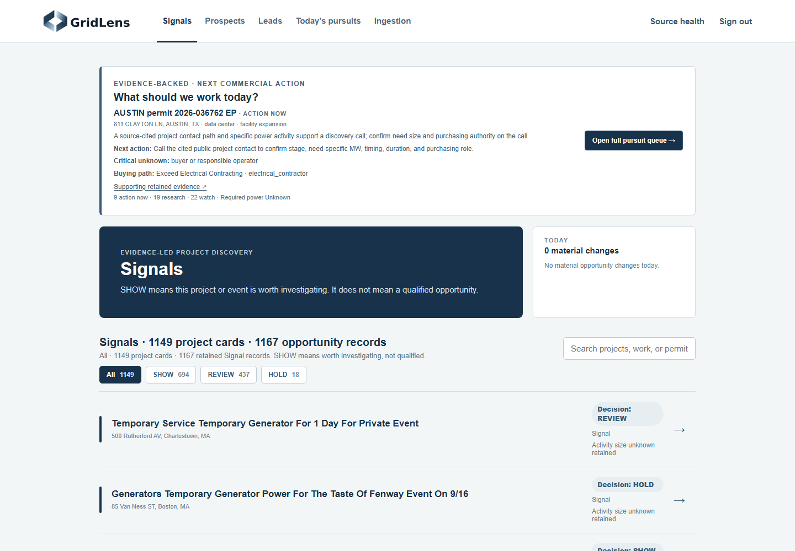
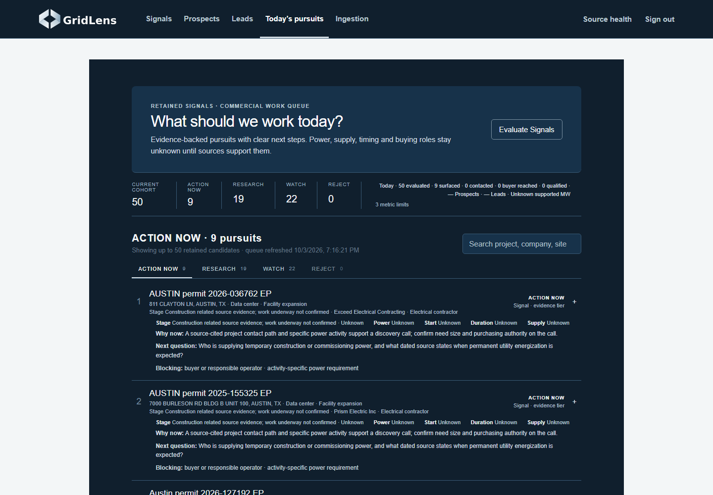
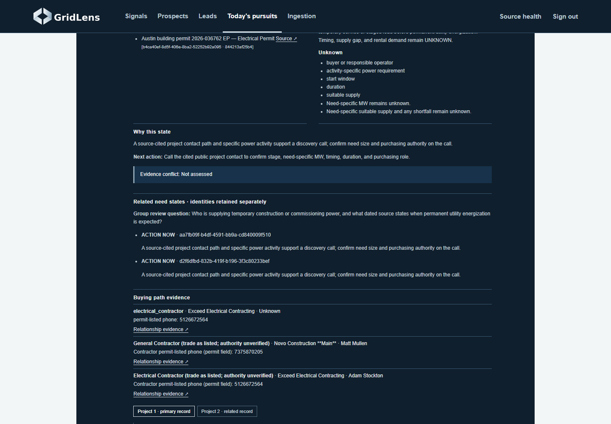
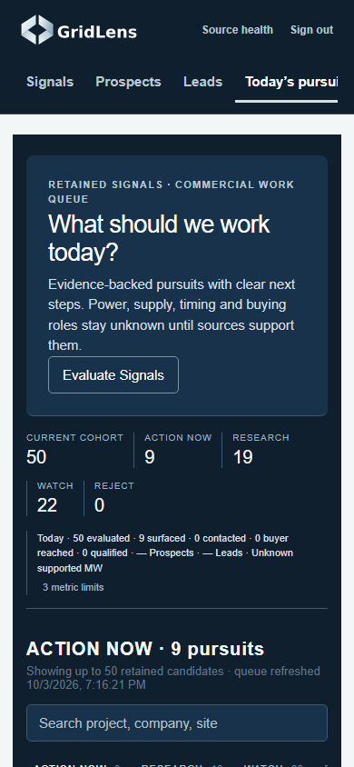

# GL3-029 commercial pursuits: retained-data acceptance

**Post-merge status (October 4):** PR23 merged to main at `6c8bdf3e3163adde078f8543d43c0256bc11eb82`; its tree matches the independent Sol [PASS review](../../.agent/artifacts/GL3-029-PR23/REVIEW.json) and [source manifest](../../.agent/artifacts/GL3-029-PR23/SOURCE-MANIFEST.json). Main Actions run `37164959427` completed backend/web successfully. The review and merge-pending statements below document the earlier candidate checkpoint. The retained-corpus 50-scope result is historical local validation, not present runtime or Lead proof.

Base: `ffb1da2c7d683aa7dac89baa3964b636a1b8a2aa` (merged PR22). Branch: `feat/commercial-pursuits`. Product launch remains OPEN. PR23 was delivered for independent review. The owner subsequently authorized validation and merge only after the candidate passes and review findings are resolved. No outreach or deployment is included.

## Retained corpus

The immutable GL3-028 retained backup contains 16,960 evidence rows and 1,168 active Signal needs; the existing authoritative projection admits 1,167. A fresh isolated PostgreSQL clone was upgraded from 0011 to 0013. Eleven authoritative tables retained identical row counts and SHA-256 digests across upgrade and commercial evaluation. The strongest 50 distinct work scopes reference 53 existing Signal needs. Exact Austin BP/EP case and full unit/building address can share a work scope; underlying Project and PowerNeed identities remain separate.

Final conversion: **9 ACTION NOW / 19 RESEARCH / 22 WATCH / 0 REJECT**. Unchanged evaluation replay preserved classification, input hash, daily counters and saved history versions/timestamps. Daily receipts: 50 evaluated, 9 newly surfaced; no contacted, reached-buyer or qualified outcomes were recorded. Promotion history and a reliable grouped MW total are explicitly UNKNOWN. Provider calls: 0. The initial cohort request took 9.594 seconds; the final merge-repair replay request took 3.500 seconds. These are local timings, not a performance guarantee.

## Conversion logic

Use existing active Signal admission and current evidence. Prioritize specific data-center construction, then commissioning, source-supported O&G production/fixed-asset phase, then explicit temporary-service activity. Unproven drilling approvals and formation/standby-generator filings do not gain phase priority from regulatory boilerplate. Within relevance classes, prefer DFW, Austin, Houston, El Paso, California, then other regions; source dates and stable IDs break ties. MW/nameplate is not a ranking factor.

Exact-case sibling groups expose each need's disposition, closure, hold and conflict state; incompatible sibling states produce RESEARCH with a concrete conflict question, independent of input order. Supported closure/routine backup replacement/adequate permanent supply or an evidenced intermediary-only path produces REJECT. Current holds/conflicts require RESEARCH. A cited reachable project contact plus a specific power activity supports an ACTION NOW discovery call even with unknown MW. Formation/standby-only data centers and early projects get WATCH with a named future event. Other credible scopes get up to two missing-fact blockers and a focused research question. Facts, hypotheses, unknowns, commercial state and evidence tier remain separate.

Evaluation receipts and operator notes reuse Pursuit records. Meaningfully changed input hashes or dispositions append immutable as-of versions in existing Pursuit JSON; unchanged replay does not append or rewrite version timestamps. A separate searchable saved-history view keeps previously evaluated records and notes accessible after they leave today's cohort; snapshots are dated and explicitly not rechecked, and older metadata-only receipts do not reconstruct facts. Targeted questions reuse the existing bounded PowerNeed brief worker and question/evidence fingerprint; unchanged cached or pending work is reused. The UI polls an authenticated exact-question status route through pending to ready/failed without resubmitting the model request. This action interprets retained evidence; it does not acquire missing external facts. The existing buying-chain source review remains available in card detail.

## Ten leading candidates manually inspected

Each row was checked against retained source excerpts, exact need/project membership and content hashes. Related BP/EP sources were checked against their own existing Project IDs. Contractor names, roles and public permit phones are routing evidence; individual purchasing authority is unverified. Permits establish scope/permitting evidence, not work underway. All ten remain Signal; all have UNKNOWN need-specific MW, permanent-service timing and rental demand.

| Pursuit / state | Retained scope and buying path | Next useful action and limits |
|---|---|---|
| [Modular data-center foundation, 811 Clayton Ln](https://abc.austintexas.gov/web/permit/public-search-other?t_detail=1&t_selected_folderrsn=13676771) · **ACTION NOW** | Approved foundation scope; current work start is not established. Exceed Electrical Contracting (5126672564); Novo Construction **Main** (7375870205) | Ask Exceed Electrical / Novo who owns construction and commissioning power, current mobilization, and permanent energization. Need-specific MW, current phase, utility timing and buying authority UNKNOWN. |
| [Data-center expansion, 7000 Burleson Rd Bldg B Unit 100](https://abc.austintexas.gov/web/permit/public-search-other?t_detail=1&t_selected_folderrsn=13624980) · **ACTION NOW** | Finish-out expansion includes two AE transformers; source does not state utility delay. Prism Electric Inc (5129262000); Preston Flynn (5124407643) | Ask Prism Electric for current electrical/commissioning schedule and temporary-power package ownership. Need-specific MW, commissioning date and utility adequacy UNKNOWN. |
| [Data-center conversion, 400 S LaSalle St](https://data.cityofchicago.org/resource/ydr8-5enu.json?%24where=id%3D%273451848%27&%24limit=1) · **RESEARCH** | Phase3 office-to-data-center MEP conversion is permit scope; work underway not confirmed. Permit lists ABCO / Bonus / Kelso-Burnett electrical contractors and ARCO/Murray GC; public contact path UNKNOWN. | Find a cited public project contact at ABCO/Bonus/Kelso-Burnett or ARCO/Murray; then ask power-package ownership and energization. Reachable contact, current stage, load and purchasing authority UNKNOWN. |
| [Temporary-power permit, 833 1/2 E Braker Ln](https://abc.austintexas.gov/web/permit/public-search-other?t_detail=1&t_selected_folderrsn=13779660) · **ACTION NOW** | Active filing explicitly describes temporary power and references another building permit. JLC Electrical Contractor corp (9362050119) | Ask JLC Electrical whether temporary service covers the site or generation is needed; confirm size and schedule. Underlying project scope and qualifying load UNKNOWN; the referenced permit is not silently joined. |
| [Temporary-power permit, 9313 1/2 Cameron Rd](https://abc.austintexas.gov/web/permit/public-search-other?t_detail=1&t_selected_folderrsn=13769214) · **ACTION NOW** | Active filing explicitly describes temporary power. T & T ELECTRIC LLC (6025102699) | Ask T&T Electric who supplies temporary power, site-wide load, and permanent-service timing. Project purpose, MW and generation demand UNKNOWN. |
| [Temporary-power permit, 7335 1/2 Bluff Springs Rd](https://abc.austintexas.gov/web/permit/public-search-other?t_detail=1&t_selected_folderrsn=13766140) · **ACTION NOW** | Source states 200A temporary power; voltage/phase and site-wide need absent. IES Residential, Inc. (5122520040) | Ask IES Residential for voltage/phase and total temporary load first; reject if confirmed below 300 kW. WEAK rental fit until threshold verified. Do not convert amperage to MW or infer rental demand. |
| [Construction-power permit, 2631 1/2 Kramer Ln](https://abc.austintexas.gov/web/permit/public-search-other?t_detail=1&t_selected_folderrsn=13759135) · **ACTION NOW** | 800A temporary service with site, crane and hoist service scopes; no need-specific MW stated. O.C. Electric (5125633944) | Ask O.C. Electric whether temporary utility service is adequate and who owns any supplemental package. Voltage, real demand, utility adequacy, duration and supplier UNKNOWN. |
| [Jobsite construction power, 4800 1/2 E Riverside Dr](https://abc.austintexas.gov/web/permit/public-search-other?t_detail=1&t_selected_folderrsn=13735989) · **ACTION NOW** | Explicit temporary construction-power scope references a building permit. Facility Solutions Group (5128370022) | Ask Facility Solutions Group for the current job phase, total temporary load and power-package owner. Need-specific MW, current mobilization and generation demand UNKNOWN. |
| [Crane construction power, 8178 1/2 N MoPac](https://abc.austintexas.gov/web/permit/public-search-other?t_detail=1&t_selected_folderrsn=13688660) · **ACTION NOW** | Source states 600 amp temporary construction service for a crane. Brandt Electrical Services, Inc. (2816933383) | Ask Brandt Electrical for crane power window, temporary-service adequacy and procurement path. Voltage, need-specific MW, duration and generation demand UNKNOWN. |
| [TxDOT construction power, 5700 1/2 Levander Loop](https://abc.austintexas.gov/web/permit/public-search-other?t_detail=1&t_selected_folderrsn=13712388) · **ACTION NOW** | Temporary service for six fans and construction power tied to TxDOT project 14-0914-04-362R. T. Morales Company, LLC (2547934344) | Ask T. Morales for site-wide construction demand and power window; confirm 300 kW fit before pursuing rental. WEAK rental fit until aggregate activity-specific load is established. Fuel suitability UNKNOWN. |

The 200A Bluff Springs record and six-fan Levander record are weak rental-fit candidates. Their source facts cannot establish a 300 kW activity-specific requirement. Confirm total site demand before pursuing a 2G package; reject if the retained facts subsequently prove below the existing floor. Amperage was not converted into fabricated MW. No recommended organization was identified by retained evidence as a re-renter. No fuel suitability, utility delay or individual buyer authority was inferred.

The ordinary root URL retains the existing Signals browse with a compact, source-backed commercial next action and UNKNOWNs. The complete queue uses `?view=pursuits`. The existing nationwide-map/anchored-command design milestone remains open; this slice does not claim that implementation.

## Limits

- The cohort is permit-heavy. Only two data-center scopes currently combine phase evidence with a reachable electrical-contractor path. Chicago has useful named organizations but no retained public contact path.
- Early Georgia standby-generation filings and most W-1 approvals lack an actionable construction/production trigger; they remain WATCH. No qualifying O&G production transition was established in this cohort.
- Temporary utility service may already be adequate; explicit temporary-power scope does not prove generator rental demand. Two leading small-scope candidates need a threshold check.
- Bounded brief research cannot invent facts absent from retained evidence. No new web acquisition or provider call was used for this acceptance run.
- Daily evaluation/surfacing count distinct work receipts; contact/reached/qualified metrics require explicit operator notes. Historical tier-promotion counts and a supported grouped MW total are unavailable in this snapshot.
- The full existing opportunity projection takes roughly nine seconds on this retained clone.

## Validation

All local final gates passed:

- Backend: `uv run ruff check src tests migrations ../scripts`; `uv run mypy src`; `uv run pytest` — **722 passed, one unchanged environment-dependent skip**.
- Migrations: clean upgrade, repeat upgrade, drift check, downgrade to 0011/re-upgrade; retained-schema upgrade, repeat and drift check. Eleven authoritative tables retained identical counts and hashes.
- Frontend: `npm run typecheck`, `npm run build`, `npm audit --audit-level=high` passed.
- Browser: `npx playwright test --workers=1 --trace retain-on-failure` — **32 passed**, including existing workflows and new commercial/error-isolation tests.
- Real corpus: 50 work scopes / 53 Signal needs; replay stable; no evidence-tier writes or provider calls. Top ten source/contact records manually inspected.
- Runtime: authenticated retained-corpus desktop/detail/mobile capture; no page errors or mobile document overflow. `git diff --check` passed.

Source manifest SHA-256: `82f82cc2b20b518a9e598b93f1e4fc418a7b2bc3ae1beeb1965706a71f9f339a`. The final integrated repair was frozen before the full final gates. Original retained backup SHA-256: `828beace65cd2b06182f30e4713857656a993d3969c8cbecb02e6ee40ff8a886`. Private local validation logs and raw corpus receipts remain under `.artifacts/commercial/`; they are not published as customer data.

Independent review remains required. This slice does not claim deployment or completion of the parent launch contract.
