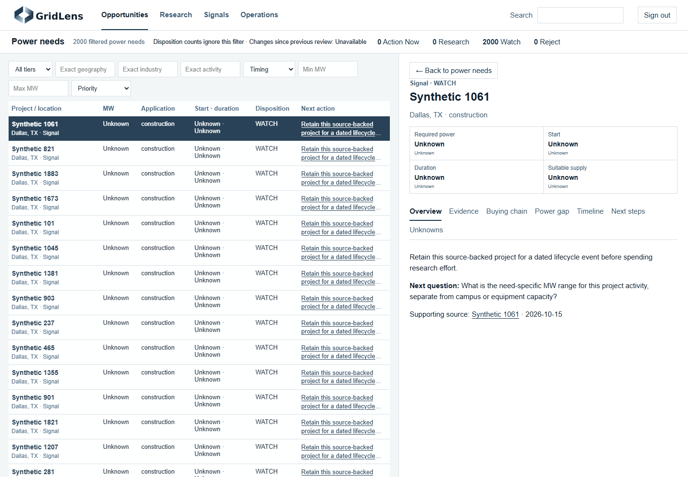
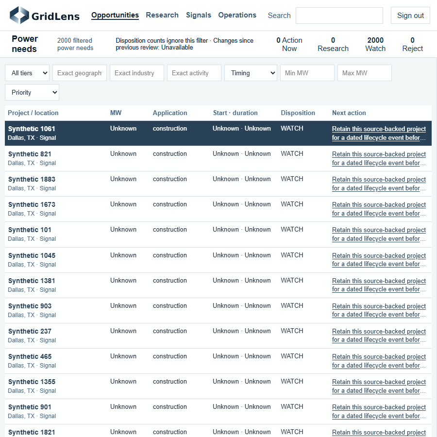
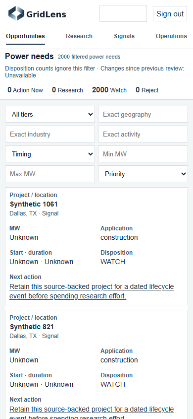
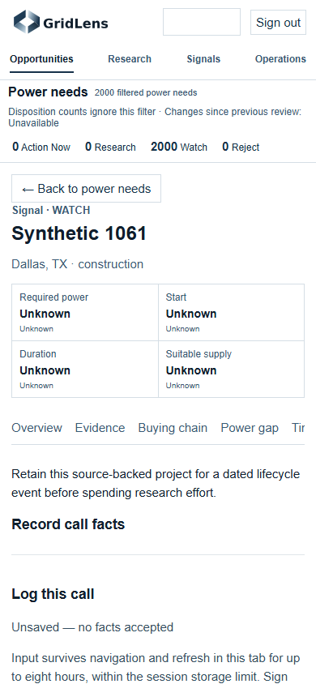
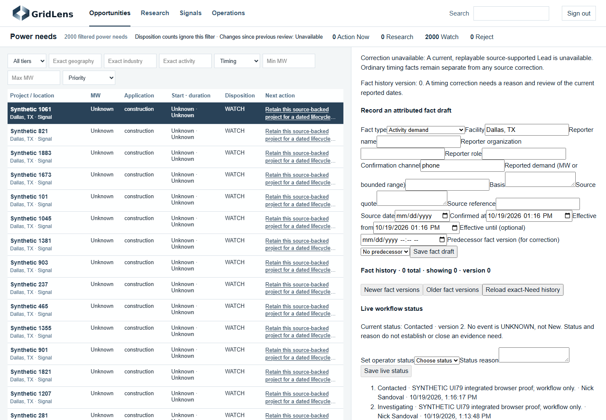

# Issue 79 Pursuit Workspace delivery

The owner-approved Pursuit Workspace replaces the default atmospheric/map-first presentation with a compact horizontal header, factual briefing, server-backed power-need table and contextual intelligence. The canonical contract is [UI_CANON](../design/UI_CANON.md) and [PURSUIT_WORKSPACE](../design/PURSUIT_WORKSPACE.md). The original Aperture assets, data, migrations, authentication, qualification doctrine and existing research/fact/workflow systems remain in place.

## Candidate and scope

Branch `feat/pursuit-workspace-79` preserves prior work at `cd84b77` and integrates current main `211d744eb3ecf58e0ffd27ecf6a82d83a68c8b03`. This is a UI/API delivery candidate. It does not close the parent product Finish Contract, prove commercial qualification, authorize outreach, or authorize production deployment. Main's intelligence operations and bounded incremental/full browse publication are retained.

`GET /api/opportunities/workspace` provides full-cohort search, independent tier/disposition filters, exact geography/industry/activity filters, timing/MW filters, stable sorts, bounded pagination and cohort tokens. Counts represent individual power needs; disposition facets ignore only the disposition filter. They are not project or grouped-pursuit counts. Material changes since prior review remain unavailable without a supported reviewed-at comparison.

Canonical need detail, evidence, buying chain, call facts, workflow status and history reuse existing APIs/components. Unknown supply produces no numerical gap. Remaining gap is exposed only through guarded, current qualification output. Workflow saves require persisted readback and do not establish qualification. Important fact summaries distinguish reported/derived, conflict and unavailable evidence states rather than assuming verification.

## Local measurements

Measured October 19, 2026 on local PostgreSQL 18 and the same synthetic fixture shape in separate databases: 2,000 power needs, 6,000 observations, 6,000 evidence records. All existing migrations through `0031_research_browse` and `alembic check` passed on fresh runtime databases. Original fixture databases were preserved; the prior synthetic corpus was dumped before reuse. No retained or production database was changed.

Ten sequential in-process TestClient samples per successful endpoint, with no network or concurrent-load claim:

| Operation | Current main median / max ms | Workspace candidate median / max ms |
| --- | ---: | ---: |
| List | 7.58 / 33.69 | 32.22 / 57.22 |
| Geography filter | 13.51 / 50.40 | 22.34 / 67.42 |
| Sort | 7.31 / 8.78 | 33.54 / 49.83 |
| Need detail | 36.71 / 86.88 | 43.45 / 93.99 |

The old list and new workspace endpoints perform different work: the candidate also returns commercial previews and disposition facets. These results do **not** establish a speed improvement. The existing commercial triage request returned HTTP 413 on this fixture; the new workspace returned a bounded 25-record page and accurate 2,000-record total. The baseline sort is existing updated order; the candidate sort is project order, so those timings are descriptive, not a matched ordering benchmark.

The automated browser journey measured 361 ms from login submission to rendered queue, 113 ms for keyboard selection through evidence display, 159 ms to open Next steps, 374 ms for status persistence/render, 47 ms for filtering and 39 ms for sorting. These are single local synthetic samples, not human task-time measurements or production SLO evidence. The stored workflow readback matched, while tier, required power, supply, remaining gap and qualification version remained unchanged. Browser capture found no page errors, with scroll width equal to viewport at 900 and 390 pixels.

Raw local receipts are under ignored `.artifacts/UI79/resume/`: preparation/schema results, baseline and candidate benchmarks, runtime proof, asset hashes and final gate logs. Failed harness attempts remain retained: one relative API request lacked a browser base URL; another attempted a workflow save before initial history/detail loading finished. The corrected harness waits for those reads before interacting.

## Screenshots

All records shown below are **synthetic test data**.

## Verification and release boundary

Final integrated validation and independent review results are recorded with the frozen candidate in the UI79 handoff. Focused development proof already covers server filtering beyond one page, tier/disposition independence, cohort drift, qualified/unknown/conflicting gaps, authentication, navigation, mobile actions and stale-response protection. All 29 original brand files match current main byte for byte.

Known boundaries:

- Production corpus size, latency and a real user's opportunity-to-action time remain **UNKNOWN**. Synthetic proof cannot establish the production 60-second target.
- Start ordering uses retained source text; it does not infer calendar chronology from ambiguous source windows. Exact-value dimension filters preserve existing stored semantics.
- Source changes alter the saved-browse policy fingerprint. A compatible generation must be rebuilt/published before workspace reads succeed; unavailable/stale generations return an explicit retryable error. The isolated rebuild passed. Production publication is a future authorized rollout gate.
- Automated provider research was disabled and API keys blanked in local verification. No paid providers, production authentication, ingestion workers, deployment or outreach were exercised.
- This PR is reviewable implementation evidence. Merge and deployment remain subject to explicit owner approval and their applicable verification gates.
